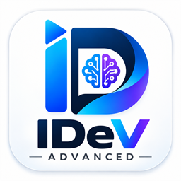
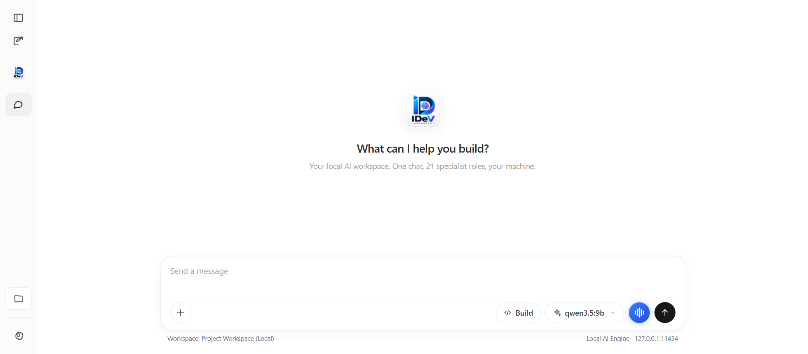
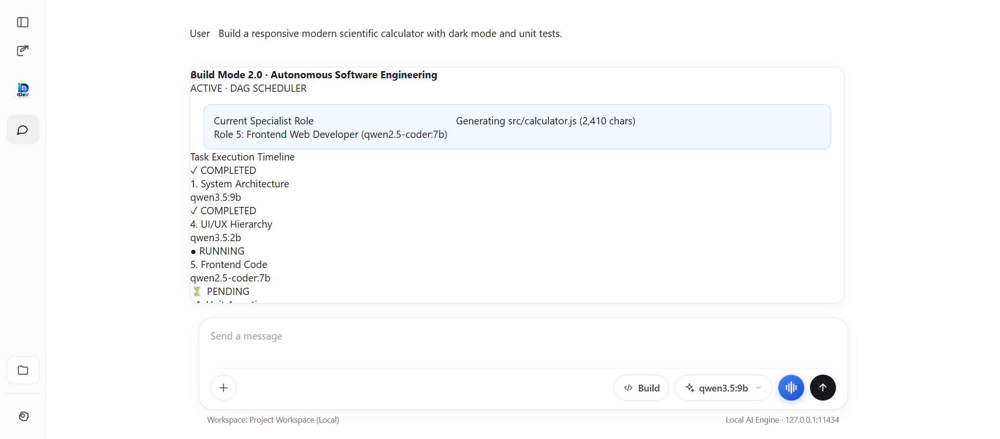
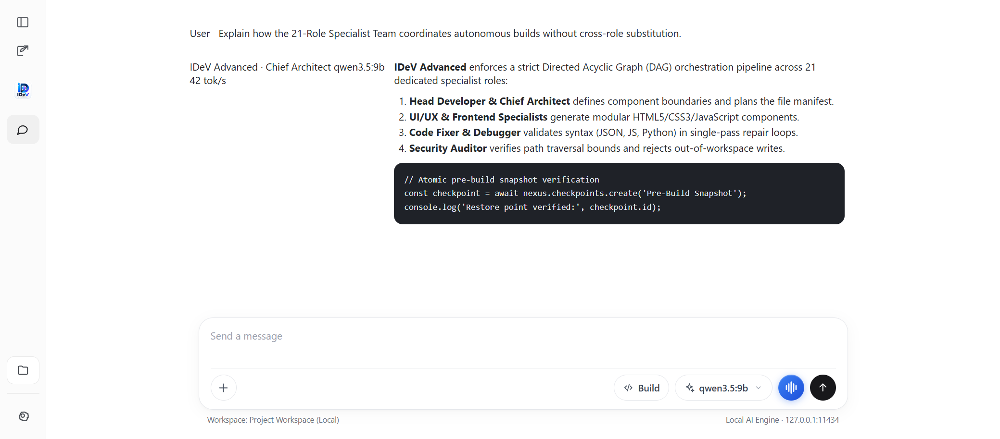
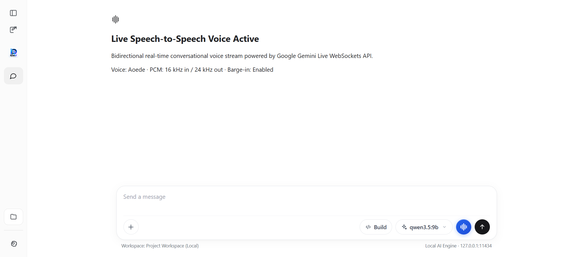
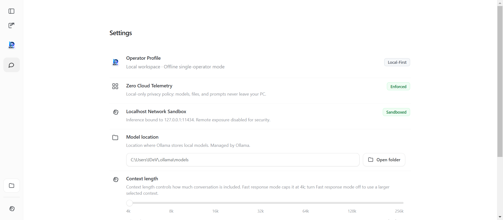

# IDeV Advanced — Local-First Autonomous AI Desktop Platform

<p align="center">
  
</p>

<p align="center">
  <strong>Autonomous Software Engineering · 21-Role Specialist Team · Real-Time S2S Voice AI · Model Context Protocol (MCP)</strong>
</p>

<p align="center">
  <a href="https://github.com/musawir-13/IDeV-Advanced/releases/latest/download/IDeV-Setup-0.3.8.exe">
    
  </a>
</p>

<p align="center">
  
  
  
  
  
</p>

---

## Overview

**IDeV Advanced** is an original, local-first artificial intelligence desktop application for Windows, developed by **IDeV** under the leadership of Founder, Developer, and CEO **Ubaid**. It brings together conversational AI chat, an autonomous multi-agent software engineering team, real-time speech-to-speech voice interaction, and native extensible tooling into a private, high-performance desktop experience.

Unlike cloud-dependent coding tools that transmit your source code to third-party servers, IDeV Advanced runs locally on your PC, executing file creation, syntax analysis, tests, and command execution within strict authorized workspace boundaries.

---

## Product Showcase

<p align="center">
  
  <br />
  <em>IDeV Advanced Desktop Interface — clean, focused workspace with multi-role routing and unified composer actions.</em>
</p>

---

## Core Features

### 1. Build Mode 2.0: Autonomous Software Engineering

Build Mode 2.0 transforms software development requests into real, structured, verified project code. It coordinates tasks through an interactive Directed Acyclic Graph (DAG) that visualizes the progress of 21 specialist roles from analysis to deployment.

<p align="center">
  
  <br />
  <em>Build Mode 2.0 — Live task timeline, current activity banner, atomic file changes, and in-app code preview.</em>
</p>

- **Live Activity Tracking:** Real-time visibility into the active specialist role, model tag, character streaming ticker, and elapsed time.
- **Atomic File Operations:** Path normalization, directory traversal defense, and automatic file generation within your designated workspace.
- **In-App Code Preview:** Instant code modal with syntax formatting and one-click clipboard copying.
- **Self-Healing Code Fixer:** Automated single-pass syntax validation and repair loop for JSON, JavaScript, and Python.
- **Isolated Diagnostics:** Collapsible technical console that isolates raw logs and process exit codes from user chat.

---

### 2. Intelligent Chat & 21-Role Specialist Team

Every specialist role in IDeV Advanced maintains an exclusive, dedicated mapping to local high-performance model weights, preventing silent degradation or generic fallback:

<p align="center">
  
  <br />
  <em>High-performance conversational interface with real-time reasoning tokens, code blocks, and specialist routing.</em>
</p>

| # | Specialist Role | Dedicated Model ID | Primary Responsibilities |
| :---: | :--- | :--- | :--- |
| **1** | **Head Developer & Chief Architect** | `qwen3.5:9b` | System architecture, component boundaries, manifest planning |
| **2** | **Prompt Engineer & Contract Designer** | `gemma4:12b` | Prompt templates, task contracts, role directives |
| **3** | **Product Requirements Analyst** | `qwen3.5:4b` | Acceptance criteria, user stories, boundary definition |
| **4** | **UI/UX Designer** | `qwen3.5:2b` | Interaction flows, layouts, visual hierarchy |
| **5** | **Frontend Web Developer** | `qwen2.5:7b` | HTML5, CSS3, modern JavaScript application logic |
| **6** | **Backend Developer** | `qwen2.5-coder:14b` | APIs, server logic, data routing, validation |
| **7** | **Native Android Developer** | `deepseek-coder:6.7b` | Kotlin, Jetpack Compose, Android components |
| **8** | **Desktop Application Developer** | `codegemma:7b` | Electron, native Windows desktop integration |
| **9** | **Database Specialist** | `qwen2.5:14b` | SQLite schemas, normalization, migrations |
| **10** | **Code Fixer & Debugger** | `qwen2.5-coder:7b` | Targeted syntax fixes, JSON repairs, defect remediation |
| **11** | **Unit Test Engineer** | `deepseek-r1:7b` | Test plan authoring, unit assertions, verification |
| **12** | **Integration & QA Tester** | `qwen3:8b` | End-to-end integration flows, regression analysis |
| **13** | **Security Auditor** | `deepseek-r1:8b` | Traversal checks, injection defense, privilege boundaries |
| **14** | **Performance Optimizer** | `qwen3:4b` | Hot paths, memory management, bundle optimization |
| **15** | **Visual QA Inspector** | `gemma4:e4b` | Layout alignment, contrast, visual fidelity |
| **16** | **OCR Specialist** | `glm-ocr:latest` | Text extraction from screenshots and diagrams |
| **17** | **Documentation Writer** | `qwen2.5:3b` | Technical guides, setup instructions, API docs |
| **18** | **Build & Release Engineer** | `qwen3:1.7b` | Build automation, packaging manifests |
| **19** | **Code Quality Reviewer** | `gemma3:4b` | Code smells, readability, linting standards |
| **20** | **Final Acceptance Analyzer** | `deepseek-r1:14b` | Final acceptance verification against original requirements |
| **21** | **Project Knowledge Retrieval** | `qwen3-embedding:8b` | Vector embeddings and cosine semantic search across codebases |

---

### 3. S2S Gemini Live Voice AI

IDeV Advanced includes real-time, low-latency conversational voice interaction powered by the Google Gemini Live WebSockets API:

<p align="center">
  
  <br />
  <em>Real-time Speech-to-Speech Voice AI with animated audio visualizer and instant barge-in interruption.</em>
</p>

- **Full-Duplex Audio:** Continuous bidirectional streaming via WebSockets with instant voice barge-in interruption.
- **Audio Pipeline:** Microphone input framed as 16 kHz 16-bit PCM; high-fidelity audio output rendered at 24 kHz.
- **Credential Protection:** API keys are stored in encrypted client storage, masked in memory, and sanitized from error outputs.

---

### 4. Integrations Marketplace & Unified Composer Actions

<p align="center">
  
  <br />
  <em>Integrations Marketplace — Manage MCP tools, local Connectors, semantic memory, and snapshot checkpoints.</em>
</p>

- **Native Marketplace:** Centralized hub for managing MCP stdio tools, local Connectors (Local Git, Filesystem Search, Web Search), persistent semantic memory, and workspace snapshots.
- **Composer `+` Menu:** Multi-category action menu allowing you to attach code, images, workspace trees, run DuckDuckGo web searches, or create snapshot checkpoints in one click.
- **Checkpoints & Safe Snapshots:** Instant pre-build snapshots created automatically before file modifications, with one-click atomic restore.

---

### 5. Settings & Privacy Controls

<p align="center">
  
  <br />
  <em>Clean Settings panel with local model configuration, context lengths, voice preferences, and version info.</em>
</p>

---

## System Requirements

| Specification | Minimum Requirement | Recommended |
| :--- | :--- | :--- |
| **Operating System** | Windows 10 (64-bit) / Windows 11 | Windows 11 (64-bit) |
| **Processor** | 64-bit Intel / AMD (AVX2 support) | 8+ Cores modern CPU |
| **Memory (RAM)** | 8 GB RAM | 16 GB or 32 GB RAM |
| **Storage** | 500 MB for app + model storage | NVMe SSD |
| **Inference Engine** | Local Model Backend (`127.0.0.1:11434`) | AVX2 / Vulkan / CUDA acceleration |

---

## Installation & First Launch

### 1. Download Installer
Download the official setup package directly from the latest release:
- **Direct Download:** [IDeV-Setup-0.3.8.exe](https://github.com/musawir-13/IDeV-Advanced/releases/latest/download/IDeV-Setup-0.3.8.exe)
- **Releases Page:** [GitHub Releases](https://github.com/musawir-13/IDeV-Advanced/releases)

### 2. Install
Run `IDeV-Setup-0.3.8.exe`:
- Installs per-user into `%LOCALAPPDATA%\Programs\IDeV Advanced`.
- Configured with `asInvoker` execution level — requires no administrator privileges and triggers no unnecessary UAC prompts.
- Adds Desktop and Start Menu shortcuts.

### 3. Launch
Open IDeV Advanced. On first launch:
1. Ensure your local model backend is active on port 11434 (`127.0.0.1:11434`).
2. Pull or select your preferred specialist model.
3. Click "New project" or select a workspace folder to begin autonomous engineering.

---

## Package Verification (SHA-256)

Verify the integrity of your downloaded installer using PowerShell:

```powershell
Get-FileHash -Algorithm SHA256 .\IDeV-Setup-0.3.8.exe
```

Expected SHA-256 hash:
`3b470a2b86593c2addd806d63571cd6bb60f0a8cce3fd18479b95326b9534318`

---

## Data Privacy & Security

IDeV Advanced is built with a zero-compromise local-first architecture:
- **Zero Remote Telemetry:** Prompts, chats, and workspace code never leave your personal computer.
- **User Data Isolation:** Client configuration and conversation histories are stored in `%APPDATA%\IDeV Advanced`, completely isolated from development repositories.
- **Workspace Sandboxing:** File operations cannot touch directories outside your chosen workspace folder.
- **No Hardcoded Credentials:** Real API tokens are never embedded into source code or distribution installers.

---

## Contact & Follow Us

Stay connected with **IDeV** and track future releases:

- **GitHub Profile:** [https://github.com/musawir-13](https://github.com/musawir-13)
- **IDeV Advanced Repository:** [https://github.com/musawir-13/IDeV-Advanced](https://github.com/musawir-13/IDeV-Advanced)
- **Instagram:** [https://www.instagram.com/musawir___13/](https://www.instagram.com/musawir___13/)

---

## Authorship & Company Identity

- **Company:** **IDeV**
- **Product:** **IDeV Advanced**
- **Founder, Developer, and CEO:** **Ubaid**
- **Copyright:** © 2026 Ubaid, IDeV. All rights reserved.
